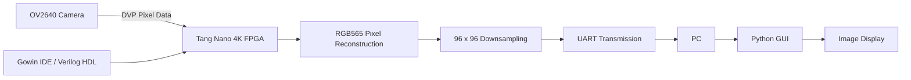

# tang_nano_4k_fpga_board
# FPGA-Based Image Acquisition Using Tang Nano 4K and OV2640

## Project Overview
This project implements an FPGA-based image acquisition system using the Tang Nano 4K development board and OV2640 camera module. The system captures image data, reconstructs pixels in RGB565 format, downsamples the image to 96 × 96 resolution, and transmits the captured data to a PC through UART. A Python-based GUI reconstructs and displays the received image.

## Objectives
- Interface the OV2640 camera with the Tang Nano 4K FPGA.
- Configure camera registers using the SCCB interface.
- Capture image data using the camera's DVP interface.
- Reconstruct 16-bit RGB565 pixel data.
- Downsample images to reduce memory and transmission requirements.
- Transfer image data to a PC using UART.
- Display the received image using a Python GUI.

## Hardware Components
- Sipeed Tang Nano 4K FPGA development board
- OV2640 camera module
- USB connection for FPGA programming and serial communication
- PC for image reception and visualization

## Software and Technologies
- Gowin IDE
- Verilog HDL
- Python
- UART serial communication
- RGB565 pixel format
- SCCB camera configuration

## System Architecture



## Implementation
The OV2640 camera is configured through the SCCB interface. Image data is captured through its 8-bit DVP interface using PCLK, HREF and VSYNC signals. The FPGA reconstructs the pixel information into RGB565 format and reduces the image resolution to 96 × 96 pixels. The resulting image data is transmitted to a PC using UART, where a Python GUI reconstructs and displays the image.

## Results
- Successfully interfaced the OV2640 camera with the Tang Nano 4K FPGA.
- Verified image acquisition using camera test patterns and live camera output.
- Implemented RGB565 pixel reconstruction and 96 × 96 image downsampling.
- Successfully transferred image data through UART.
- Displayed received images using a Python-based GUI.

## Repository Structure

```text
tang_nano_4k_fpga_board/
├── src/
├── impl/
├── images/
├── fpga_project_delta.gprj
└── README.md
```

## Applications
- FPGA-based image acquisition
- Embedded vision systems
- Hardware-level image processing
- Resource-constrained edge devices

